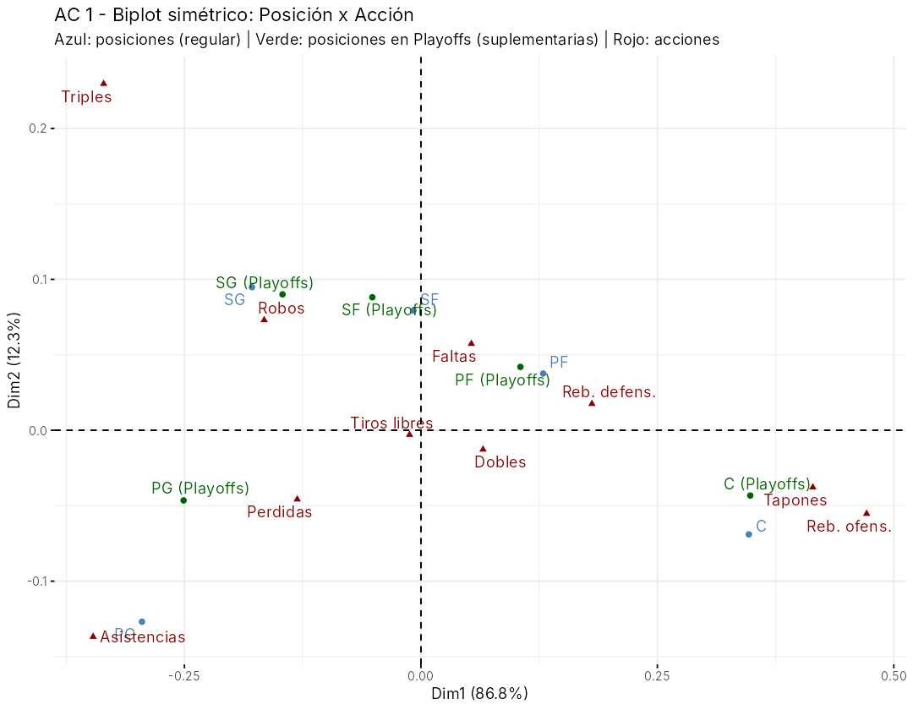
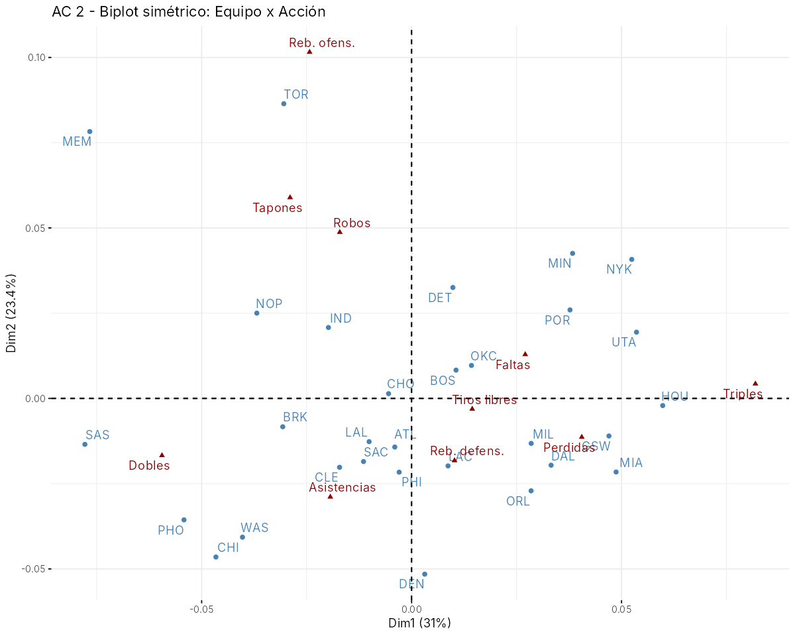
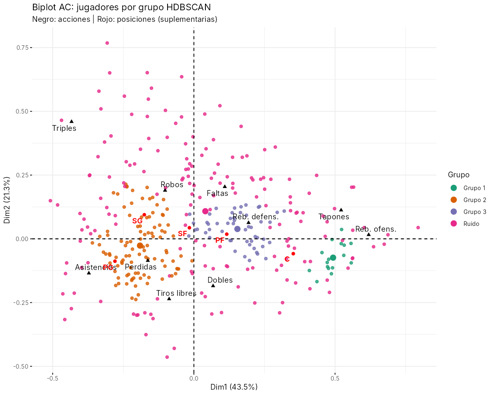

# Análisis de Correspondencia en R – Estadísticas NBA 2021-2022

## Contenido

| Archivo | Descripción |
|---|---|
| `datos/` | CSV originales (temporada regular y playoffs). Separador `;`, decimal `.`, codificación Windows-1252. |
| `analisis_correspondencia.R` | Script completo del análisis. |
| `resultados/` | Gráficos (`.png`) y salida de consola (`salida_consola.txt`). |

Ejecutar desde la carpeta del proyecto:

```r
source("analisis_correspondencia.R")
```

Paquetes: `FactoMineR`, `factoextra`, `gplots`, `ggplot2` (el script los instala si faltan).

## Planteamiento

El análisis de correspondencia trabaja sobre una **tabla de contingencia** (frecuencias). Los datos
vienen como promedios por partido, así que se multiplicó cada estadística por los partidos jugados (`G`)
para obtener el **total de acciones** de cada jugador y luego se sumó por grupo.

Preparación:
- Los jugadores traspasados aparecen varias veces (una fila por equipo y una fila `TOT`). Para el
  análisis por posición se usa una sola fila por jugador (la `TOT`); para el análisis por equipo se
  usan las filas de cada equipo y se descarta `TOT`.
- Las posiciones dobles (`SG-PG`, `C-PF`, …) se reducen a la posición principal → PG, SG, SF, PF, C.
- Acciones (columnas): triples, dobles, tiros libres, rebotes ofensivos y defensivos, asistencias,
  robos, tapones, pérdidas y faltas.

Se hacen dos análisis:
1. **AC 1 – Posición × Acción** (temporada regular). Las posiciones en *playoffs* se proyectan como
   **filas suplementarias** (no influyen en los ejes, solo se ubican en el mapa).
2. **AC 2 – Equipo × Acción** (30 equipos), para ver estilos de juego.

## Resultados AC 1: Posición × Acción

**Prueba Chi-cuadrado:** χ² = 26 074, gl = 36, p < 2.2e-16 → se rechaza la independencia: el tipo
de acción depende de la posición. Inercia total = 0.0617.

**Inercia por dimensión:**

| Dimensión | Valor propio | % inercia | % acumulado |
|---|---|---|---|
| 1 | 0.0535 | 86.8 % | 86.8 % |
| 2 | 0.0076 | 12.3 % | 99.1 % |

Con dos dimensiones se explica el **99 %** de la asociación, así que el mapa plano es prácticamente
exacto (todos los cos² en el plano 1-2 son > 0.94).



**Dimensión 1 (86.8 %) – "juego exterior vs. juego interior".**
- Lado negativo: *Asistencias* (32 % de contribución), *Triples* (15 %), robos y pérdidas → **PG** y **SG**.
- Lado positivo: *Rebotes ofensivos* (25 %), *Rebotes defensivos* (12 %), *Tapones* (9 %) → **C** y **PF**.
- **C** (48 %) y **PG** (34 %) son las posiciones que definen el eje; SF queda en el centro (cos² en Dim 1 = 0.01).

**Dimensión 2 (12.3 %) – "tirador vs. organizador".**
- Separa *Triples* (50 % de contribución, arriba) de *Asistencias* (35 %, abajo).
- Distingue al **SG** (más triples y robos) del **PG** (más asistencias y pérdidas). El **SF** está
  representado casi solo en esta dimensión (cos² = 0.91): es un perfil intermedio con algo de sesgo
  hacia el tiro exterior.

**Perfiles fila destacados (%)**: el 23.5 % de las acciones de los PG son asistencias (8.5 % en C);
los triples son el 11.2 % de las acciones de los SG y solo el 2.4 % de las de los C; los rebotes
ofensivos son el 10.8 % en C frente al 2.8 % en PG.

**Playoffs (suplementarias):** cada posición en playoffs queda junto a su homóloga de temporada
regular, es decir, los roles se mantienen. Los PG y SG en playoffs se desplazan ligeramente hacia
el centro (perfil algo menos extremo), mientras que los C conservan exactamente su posición.

**Tiros libres** y **dobles** están cerca del origen: se reparten de forma similar entre posiciones y
no discriminan.

## Resultados AC 2: Equipo × Acción

**Prueba Chi-cuadrado:** χ² = 1 963, gl = 261, p < 2.2e-16. Es significativo por el tamaño muestral
enorme, pero la **inercia total es muy baja (≈ 0.005, unas 13 veces menor que en AC 1)**: los equipos
se parecen mucho entre sí; las diferencias de estilo existen pero son sutiles. Las dos primeras
dimensiones explican el 54 % (31 % + 23.4 %).



- **Dim 1 (31 %) – triples vs. dobles:** *Dobles* (40 %) y *Triples* (34 %). A la izquierda los
  equipos de juego de media distancia/pintura: **SAS, MEM, PHO, CHI, WAS**. A la derecha los más
  volcados al triple: **HOU, UTA, NYK, MIA, GSW**.
- **Dim 2 (23.4 %) – rebote ofensivo y defensa activa:** dominada por *Rebotes ofensivos* (57 %),
  junto a robos y tapones. Arriba destacan **TOR** y **MEM** (equipos de segundas oportunidades y
  mucha actividad defensiva); abajo **DEN, CHI, PHO**, con más peso relativo de asistencias.

## Gráficos generados

| Archivo | Contenido |
|---|---|
| `01_balloonplot_posicion.png` | Tabla de contingencia Posición × Acción |
| `02_scree_posicion.png` | Inercia por dimensión (AC 1) |
| `03_biplot_posicion.png` | Biplot simétrico AC 1 con playoffs suplementarios |
| `04/05_contrib_dim*_posicion.png` | Contribución de las acciones a Dim 1 y Dim 2 |
| `06_scree_equipo.png` | Inercia por dimensión (AC 2) |
| `07_biplot_equipo.png` | Biplot simétrico AC 2 |

## Notas

- En el biplot simétrico las distancias **fila-fila** y **columna-columna** se interpretan
  directamente; la cercanía fila-columna indica asociación de forma aproximada (dirección desde el origen).
- Los totales son aproximados: los promedios vienen redondeados a un decimal antes de multiplicar por `G`.

---

# Parte 2: Análisis de Correspondencia + HDBSCAN (factoextra)

Script: `analisis_ca_hdbscan.R` → resultados en `resultados_hdbscan/`.
Paquetes adicionales: `dbscan` (HDBSCAN) y `ggrepel`, que se instala junto con `factoextra`.

## Planteamiento

1. **AC a nivel jugador:** tabla de contingencia **Jugador × Acción** (344 jugadores con ≥ 20 partidos
   y ≥ 15 minutos por partido; las mismas 10 acciones). Las 5 posiciones se agregan como filas
   suplementarias para orientar el mapa.
2. **HDBSCAN** sobre las coordenadas de los jugadores en el plano principal del AC (Dim 1-2, 64.8 % de la
   inercia). HDBSCAN busca regiones densas sin fijar el número de grupos y marca como **ruido** a los
   jugadores que no pertenecen claramente a ninguna región.
3. Gráficos con **factoextra**: `fviz_screeplot`, `fviz_ca_col`, `fviz_contrib`, `fviz_ca_row`,
   `fviz_cluster`, `fviz_ca_biplot`.

## AC Jugador × Acción

χ² = 67 431, gl = 3087, p < 2.2e-16.

| Dim | % inercia | % acumulado | Acciones que la definen |
|---|---|---|---|
| 1 | 43.5 % | 43.5 % | Reb. ofensivos (29 %), Asistencias (26 %), Triples (18 %), Reb. defensivos y Tapones (10 % c/u) |
| 2 | 21.3 % | 64.8 % | Triples (41 %), Dobles (15 %), Tiros libres (15 %), Faltas (12 %) |
| 3 | 13.1 % | 77.9 % | Asistencias (35 %), Tiros libres (32 %), Triples (15 %) |

- **Dim 1:** juego exterior/creación (izquierda) vs. juego interior (derecha), igual que en la Parte 1.
- **Dim 2:** el tirador de triples (arriba) frente al jugador que ataca el aro y saca tiros libres (abajo).
- Las posiciones (suplementarias) se ordenan PG → SG → SF → PF → C sobre la Dim 1.

## HDBSCAN

Elección de `minPts` (tamaño mínimo de grupo): se probaron valores de 5 a 25 (tabla en
`salida_consola.txt`). Con `minPts` entre 11 y 14 la solución es estable: **3 grupos**. Se usó
`minPts = 12`. Con 3 o 4 dimensiones la nube queda muy dispersa y casi todo pasa a ser ruido,
por eso se trabaja en el plano 1-2.



| Grupo | n | Posiciones | Perfil | Ejemplos |
|---|---|---|---|---|
| **1 – Pívots de pintura** | 16 | 11 C, 4 PF | Casi sin triples (0.3 %), 14 % rebote ofensivo, más tapones | Claxton, Zubac, Poeltl, Okongwu, Holmes |
| **2 – Bases / creadores** | 101 | 40 PG, 41 SG, 14 SF | 18.7 % asistencias, más tiros libres y pérdidas | Maxey, Booker, Paul George, Bledsoe, Rose |
| **3 – Aleros y grandes versátiles** | 51 | 20 SF, 16 PF, 10 C | Rebote defensivo alto (22.6 %), algo de triple, faltas | Vučević, Horford, Thaddeus Young, Wendell Carter Jr. |
| **Ruido** | 176 | todas | Perfiles que no encajan en un núcleo denso | Durant, Harden, Lillard, DeRozan, Siakam |

Promedios por partido:

| Grupo | MP | PTS | 3P | TRB | AST | STL | BLK |
|---|---|---|---|---|---|---|---|
| 1 | 22.2 | 9.4 | 0.1 | 7.0 | 1.4 | 0.6 | 0.9 |
| 2 | 27.1 | 13.6 | 1.7 | 3.9 | 3.7 | 0.9 | 0.3 |
| 3 | 22.3 | 9.4 | 0.9 | 4.7 | 1.7 | 0.7 | 0.6 |
| Ruido | 25.3 | 11.7 | 1.4 | 4.8 | 2.5 | 0.8 | 0.5 |

**Interpretación**

- Los grupos reproducen la escala exterior → interior, pero **no coinciden exactamente con las
  posiciones**: el grupo 2 junta PG y SG (y algunos SF), y el grupo 3 mezcla SF, PF y C que juegan
  parecido.
- El **51 % de ruido** es un resultado en sí mismo: los perfiles de juego en la NBA forman un
  **continuo**, no grupos bien separados. HDBSCAN solo encuentra núcleos densos de roles muy
  "típicos".
- Muchos de los jugadores de **ruido son estrellas** o especialistas con perfiles extremos. Los
  *outlier scores* (GLOSH) más altos son tiradores puros (Wayne Ellington, Patty Mills, Duncan
  Robinson, Danny Green), pívots de puro rebote y tapón (Mitchell Robinson, Nerlens Noel) y
  creadores con perfil único (Trae Young, DeRozan, Jimmy Butler).

El archivo `resultados_hdbscan/jugadores_grupos.csv` trae, para cada jugador, su grupo, la
probabilidad de pertenencia y el *outlier score*.

| Gráfico | Contenido |
|---|---|
| `01_scree.png` | Inercia por dimensión |
| `02_columnas.png` | Acciones coloreadas por contribución |
| `03/04_contrib_dim*.png` | Contribución de las acciones a Dim 1 y 2 |
| `05_jugadores_cos2.png` | Jugadores coloreados por calidad de representación |
| `06_hdbscan_arbol.png` | Árbol condensado de HDBSCAN |
| `07_fviz_cluster.png` | Grupos con `fviz_cluster` (sin ruido) |
| `08_biplot_grupos.png` | Biplot AC con jugadores coloreados por grupo |
